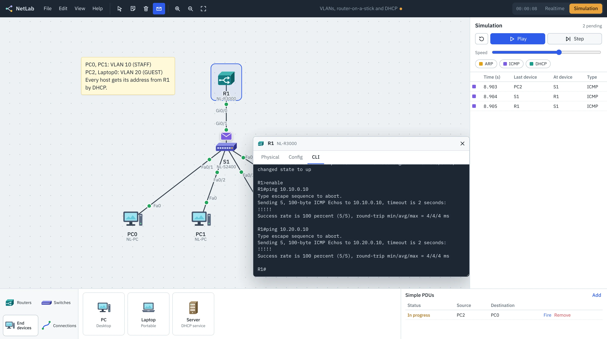

# NetLab

An open-source network simulator for the browser and the desktop. Build a topology of routers, switches and PCs, configure it from an IOS-style command line, and step through every ARP, ICMP and DHCP packet in simulation mode.



**Download:** see the [releases page](https://github.com/yashhgill/netlab/releases) or the download site. **Try it now:** open the browser version from the download site (`/app/`).

## What it simulates

| Area | Supported |
| --- | --- |
| Routers | NL-R1900 (2 × Gigabit, 2 × serial), NL-R3000 (3 × Gigabit), NL-R2900 (3 × Gigabit, 4 × serial), NL-R4400 (4 × Gigabit, 2 × fiber) |
| Switches | NL-S2400 (24 × Fast, 2 × Gigabit), NL-S2448 (48 × Fast), NL-S2960F (24 × Gigabit, 2 × fiber), NL-S3600 multilayer (24 × Gigabit, 4 × fiber), hub |
| End devices | PC, laptop, server, printer, IP phone |
| Cabling | Automatic, console, copper straight-through and cross-over, fiber, serial DCE and DTE; wrong cable types keep the link down |
| WAN | Serial links that need `clock rate` on the DCE end, HDLC or PPP encapsulation |
| Multilayer | `ip routing`, SVIs, routed ports with `no switchport` |
| Switching | MAC learning, flooding, filtering, VLANs, 802.1Q trunks, native and allowed VLANs, SVIs |
| Routing | Connected and static routes, default routes, router-on-a-stick sub-interfaces, TTL, ICMP unreachable and time exceeded |
| Services | DHCP pools on routers, DHCP server device, `ip helper-address` relay, APIPA fallback on clients |
| Tools | Inspect ARP, MAC and routing tables; power each device on and off; power cycle all; fast forward time; front-panel view with port LEDs; console Terminal on PCs |
| IOS CLI | Modes and prompts, abbreviations, `?` help, Tab completion, history, `do`, `interface range`, `show` commands (including `show cdp neighbors`, `show controllers`, `show run interface`), passwords, banners, `copy run start`, `reload` |
| PC CLI | `ipconfig` (`/all`, `/release`, `/renew`), `ping` (`-n`, `-t`), `tracert`, `arp -a` |
| Simulation | Pause time, step or play, protocol filters, event list, PDU inspector, Simple PDUs |

Not yet: dynamic routing protocols (RIP, OSPF), STP, ACLs, NAT and wireless. Contributions are welcome.

## Diagrams on the same workspace

The shapes button on the tool palette (or **S**) adds draw.io-style objects next to the live network: rectangles, rounded boxes, ellipses, diamonds, zones (shaded areas for rooms, buildings, VLANs or subnets), text, lines and arrows, plus drawing-only icons (firewall, cloud, internet, server rack, users, building, database, security, ISP tower). Lines and arrows snap to devices and shapes and follow them when they move. Select a shape to change its fill, border, dash, text size and order.

File > Export saves the workspace as PNG, SVG, PDF or a `.drawio` file. File > Open reads `.drawio` files too: shapes, text and arrows come across, and network shapes from draw.io's Cisco and network libraries become live devices, with edges between them turned into real cables.

## Opening Packet Tracer files

File > Open (or drag a file onto the window) accepts Packet Tracer `.pkt`, `.pka` and `.pkz` files from version 5 onward. NetLab decrypts the file (the format was documented by the open-source [pka2xml](https://github.com/mircodz/pka2xml) project; `app/src/pt/pkt-crypto.ts` is an independent implementation), reads the network XML and rebuilds it with the closest NetLab models:

- devices, positions, names and power state; generic and modular devices get the extra ports their modules add;
- cables, including which serial end is DCE;
- router and switch running-configs (and startup-configs), with type 7 passwords decoded;
- host addressing, DHCP, gateways and DNS; server DHCP pools; access point and client SSIDs and WPA2 keys; notes.

Devices NetLab doesn't simulate yet (clouds, modems, home routers, wireless LAN controllers) and settings it can't recover (hashed enable secrets) are listed after the file opens. Saving as `.pkt` isn't supported; use File > Export device configs to take configurations back the other way.

## Project layout

```
app/              the simulator (React + TypeScript + Vite)
  src/engine/     network engine: devices, frames, ARP, IP, switching, DHCP, event scheduler
  src/cli/        IOS-style console and PC command prompt
  src/ui/         workspace, device windows, simulation panel
  src-tauri/      desktop shell (Tauri 2)
site/             download page (static HTML)
.github/workflows CI, website deploy, desktop release builds
```

## Develop

```bash
cd app
npm install
npm run dev        # http://localhost:5173
npm test           # engine and CLI tests
npm run build      # static build in app/dist
```

Desktop app (needs Rust and the [Tauri prerequisites](https://v2.tauri.app/start/prerequisites/)):

```bash
cd app
npm run tauri dev
npm run tauri build
```

## Releasing

1. Bump the version in `app/package.json`, `app/src-tauri/tauri.conf.json` and `app/src-tauri/Cargo.toml`.
2. Push a tag: `git tag v1.0.1 && git push origin v1.0.1`.
3. The Release workflow builds `.dmg` (Apple silicon and Intel), `.exe`, `.msi`, `.AppImage` and `.deb` files and attaches them to a GitHub release. The download page reads the latest release from the GitHub API, so it updates on its own.

## Web version, accounts and AI

The website is a Cloudflare Pages project (`wrangler.toml`): the download page at `/`, the simulator at `/app/`, and the AI assistant at `/api/ai` (`functions/api/ai.ts`). Accounts and NetLab Pro use Supabase (`supabase/migrations/0001_netlab_accounts.sql`).

1. Create a Supabase project and run the migration in its SQL editor. In Authentication > URL Configuration, set the site URL to `https://netlab.harnova.my/app/` and add it to the redirect URLs.
2. Copy `.env.web.example` to `.env.web` and fill in the project URL, anon key and your DuitNow details. Put your DuitNow QR image at `brand/duitnow-qr.png`.
3. Put the Supabase URL and anon key under `[vars]` in `wrangler.toml`, then add the `GROQ_API_KEY (and optionally GEMINI_API_KEY, CEREBRAS_API_KEY, OPENROUTER_API_KEY as fallbacks)` secret in the Cloudflare Pages project settings (or `npx wrangler pages secret put GROQ_API_KEY`).
4. `./build-web.sh && npx wrangler pages deploy`
5. Sign up on the site, then make yourself admin in the SQL editor:
   `update public.profiles set is_admin = true where email = 'you@example.com';`

Users pay by DuitNow, submit their reference in the app, and you approve them from the account menu (Admin). Approving adds 1 or 12 months of Pro.

## Website

The site is served by Cloudflare Pages at `netlab.harnova.my` (custom domain set in the Pages project).

## License

MIT. NetLab is an independent project by HarNova Technology and isn't affiliated with or endorsed by any network equipment vendor. All device artwork is original.
